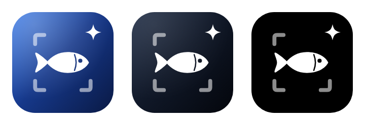
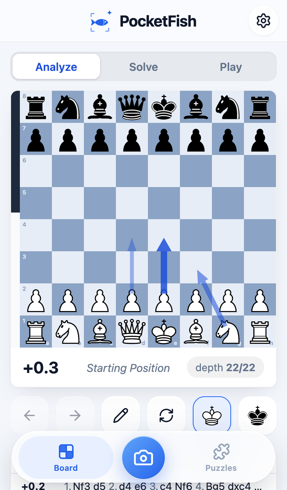
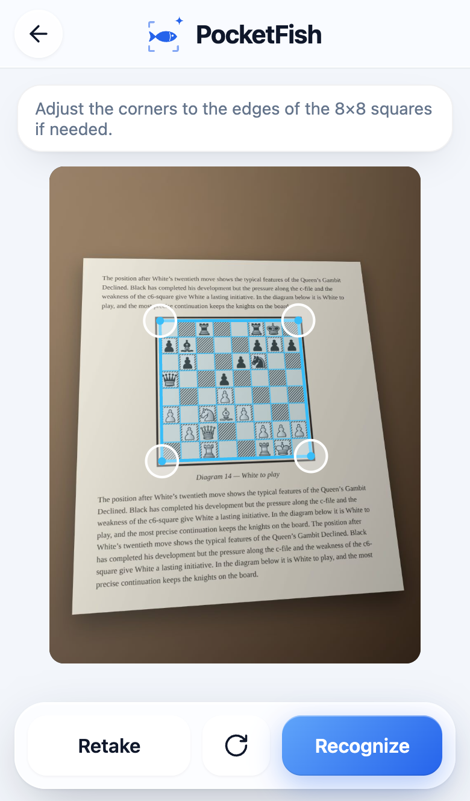
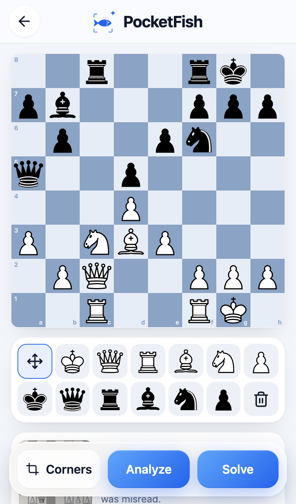
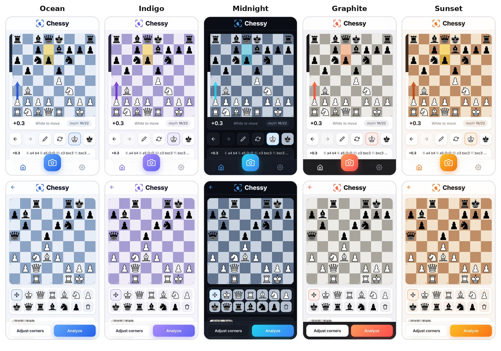
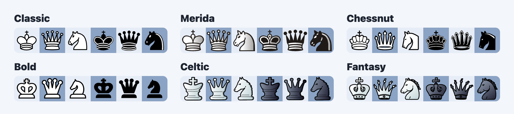
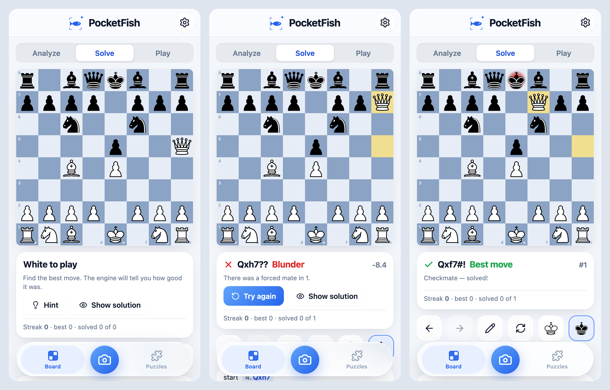
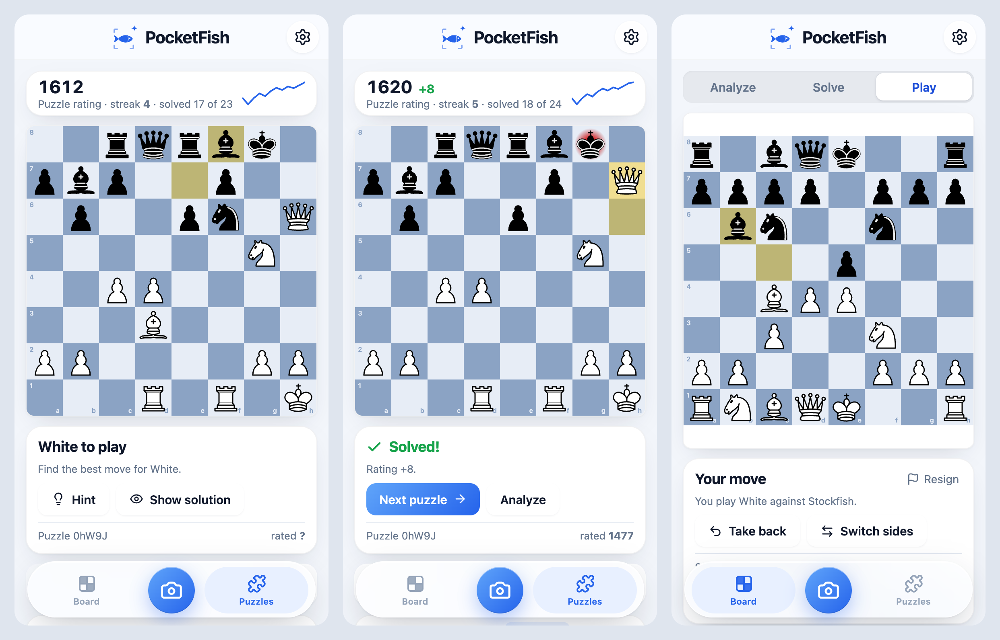

<p align="center"></p>

# PocketFish

*Stockfish in your pocket.*

Point your phone at a chess diagram in a book, a magazine or on a screen and get an
interactive board with **on-device Stockfish analysis**, like ChessExpert / Chessvision.

<p align="center">
  
  
  
</p>

## Features

- **Scan** a diagram with the camera, pick a photo / screenshot, or paste a copied picture. The board is found
  automatically (you can drag the corners, with a magnifier, if needed) and every square is
  recognised by a small neural network **running on the phone** (no server, works offline).
- **Review & fix**: the recognised position opens in an editor next to a straightened crop
  of your photo. Uncertain squares are highlighted; drag pieces or tap with a piece from the
  palette to correct them. Sideways or upside-down photos are handled automatically.
- **Whose move is it?** Pick White or Black to move. If one king is in check the app knows
  it must be that side's move and sets it for you; it refuses impossible combinations.
  Castling rights are inferred from the king/rook positions and can be toggled, and an
  en-passant capture can be allowed when the position makes one possible.
- **Diagrams printed from Black's side** are detected (from where pawns and kings stand) and
  can be flipped with one tap.
- **Analysis** with Stockfish 19 (WebAssembly, on the device): evaluation, depth, the best
  1–5 lines in SAN, and graded arrows for the top moves on the board, plus an eval bar.
- **Solve mode** (training): switch from *Analyze* to *Solve* and the engine hides its
  evaluation, arrows and lines. Find the move yourself and Stockfish tells you how good it was
  (best, good, inaccuracy, mistake, blunder, or a missed mate). Try again, ask for a hint or
  see the solution; after a good move the engine replies so a combination can be played out.
  A streak and a solved-at-first-try count are kept on the device. After a scan (or editing a
  position) you choose *Analyze* or *Solve*, so puzzle books stay puzzles.
- **Puzzles**: about 6,100 puzzles from the [lichess.org puzzle database](https://database.lichess.org/#puzzles)
  (CC0), all on the phone. A Glicko-2 **puzzle rating** that goes up for a puzzle solved at the first try and
  down for a wrong move, a hint or the solution (each puzzle counts once), with a small chart; filters by
  theme (mates in 1–3, forks, pins, sacrifices, endgames…) and difficulty; a **puzzle of the day**; your
  weakest themes; and *Analyze* opens a puzzle with its solution.
- **Play** any position out against Stockfish, the third mode next to *Analyze* and *Solve*: eight levels
  from Beginner to full strength, the captured pieces with the lead in material, take back, switch sides,
  resign, play again, and analyse the game afterwards. The game ends at checkmate, stalemate, insufficient material, the fifty-move rule or a threefold repetition.
- **Interactive board**: play moves by dragging or tapping, go back / forward, flip the board,
  promotion picker, opening names.
- **New game**: tap the Board button twice to set up the starting position (with *Undo*, in case
  it was an accident).
- Copy / paste **FEN**, open the position on **lichess.org** or **chess.com**.
- **Recent scans**: earlier scans stay one tap away (with a thumbnail of the photo).
- **Colour schemes**: Ocean, Indigo, Midnight (dark mode), Graphite and Sunset, each with a
  matching board — or *Auto*, which follows the phone's light / dark setting.
- **Six piece sets**: Classic, Merida, Chessnut, Bold, Celtic and Fantasy, plus nine board colours.
- **App icon** in light, dark and tinted versions, following the iPhone's Home Screen style (iOS 18+).
- **Private by design**: no account, no ads, no tracking, no network requests — see
  [Privacy](#privacy).
- **Sounds & feel**: move, capture and check sounds (synthesised, they follow the iPhone's silent
  switch), haptics, and a chime for right and wrong answers in Solve mode and puzzles. First-run tips
  explain scanning, the three modes, puzzles and the Board double-tap.
- **English, German, Spanish and French**: the app follows the phone's language (on iPhone also the
  per-app language in iPhone Settings), and Settings → Language picks one. Chess notation stays in English
  SAN (K, Q, R, B, N), as in most books and apps.
- **Help & feedback** in Settings: a prefilled feedback mail (or one for a misread scan), tips,
  and the app version.
- **Free, with optional tips**: every feature is free; the iPhone app takes a tip (three sizes) through the App
  Store under Settings → Help & feedback → Support PocketFish. Tips unlock nothing (setup: `store/README.md`).
- Settings: number of lines, depth, arrows, eval bar, Stockfish's win / draw / loss chances,
  coordinates, sounds, defaults for scanning.

<p align="center"></p>
<p align="center"></p>
<p align="center"></p>
<p align="center"></p>

Images and copy for the website and social posts are in [`press-kit/`](press-kit/README.md).

## Privacy

- **Nothing leaves the phone.** Board recognition (two small neural networks) and Stockfish run on
  the device, so the app needs no server and works in flight mode. `tests/e2e/privacy.spec.ts`
  checks it: a whole scan → analysis → Solve → puzzles → settings session may only load the app's own files.
- **No access to the photo library.** On iOS, *Choose from photos* uses the system photo picker,
  which hands over only the chosen photo; the app never asks for access to the library (taking a
  photo needs the camera permission, as usual). Photos are never uploaded or saved.
- **No account, ads, analytics or tracking**: the App Store privacy label is *Data Not Collected*.
- **Your data stays yours.** Settings → Privacy can switch off *Remember recent scans* (the position
  and a small thumbnail), and *Delete all data* removes everything the app stored on the device.
- The only ways out are links you tap (lichess.org, chess.com, GitHub) and feedback mails, which
  you send from your own mail app. A tip is paid through Apple (StoreKit 2, our own small plugin in
  `ios/App/App/StorePlugin.swift`, no third-party SDK): the app learns nothing about who gave it.
- **Hardened build.** The production build carries a Content Security Policy (`vite.config.ts`) that
  allows only the app's own files: no remote scripts, styles, images or connections, no plugins, no
  inline scripts. `tests/e2e/privacy.spec.ts` checks that it blocks nothing the app does. `npm audit`
  reports no known vulnerabilities, and the engine and the recognition run in Web Workers.

## How it works

```
photo ──► BoardNet (pass 1, whole photo) ──► 4 corners
      └─► BoardNet (pass 2, re-detect on the rectified crop) ──► precise corners
      └─► perspective-rectify to 256×256 ──► SquareNet ──► 64 × 13 class probabilities
          (if unsure, also tried turned by 90°/180°/270°)
      └─► chess rules (1 king each, no pawns on 1st/8th rank, ≤ 8 pawns)
      └─► orientation guess (White or Black at the bottom) + side to move (check)
      └─► editor for review ──► Stockfish
```

| part | where | notes |
| --- | --- | --- |
| UI | `src/ui`, `src/board` | React + TypeScript, an SVG board with pointer-event drag & drop |
| Engine | `src/engine` | Stockfish 19 lite (single-threaded WASM, 1.8 MB) in a Web Worker, UCI + MultiPV |
| Training | `src/training`, `src/puzzles`, `src/play` | Solve mode's move judging, puzzles (`public/puzzles.json`, built by `scripts/build-puzzles.mjs`; Glicko-2 rating), playing against the engine (Skill Level, depth and time per level) |
| Recognition | `src/vision` | dependency-free CNN inference in TypeScript (in a Web Worker), image ops, homographies |
| Models | `public/models/*.bin` | `board.bin` (BoardNet, ~0.57 M params) and `squares.bin` (SquareNet, ~0.78 M params), fp16; all rights reserved, not in the public source (see [License](#license)) |
| Model training | `ml/` | synthetic data generator + PyTorch training/export; all rights reserved, not in the public source |
| Languages | `src/i18n` | every text in `en.ts` (the source) and its translations `de.ts`, `es.ts`, `fr.ts`; `t('key', { param })` looks them up |
| Native apps | `ios/`, `android/` | Capacitor 8 projects (camera, clipboard, browser, haptics plugins) |

Both networks were trained only on procedurally generated diagrams: 16 openly licensed piece designs
and the chess glyphs of five free fonts (only licences that allow commercial use), varied in proportion and shape, drawn as printed book diagrams (hatched / grey /
dotted dark squares, frames, coordinates, old engraved pieces) and as screen boards (site
colour themes, wood/marble textures, highlights, arrows, inner coordinates), then
photographed virtually (perspective, page bend, lighting, shadows, glare, blur, moiré, noise,
JPEG).

**Languages.** TypeScript makes sure every language has every text, and `tests/unit/i18n.test.ts` that the
`{placeholders}` and `<b>`-style markup match. On iOS, the web view only reports a language the app declares
(`CFBundleLocalizations` in `ios/App/App/Info.plist`); the permission prompts are translated in
`ios/App/App/<language>.lproj/InfoPlist.strings`. A new language needs a message file, its entry in
`src/i18n/index.ts`, both iOS entries (and in the Xcode project) and a store listing; `npm run release-check`
reports what's missing on the iOS side.

**Accuracy.** On real scans from a 1921 book (old engraved piece style never seen in training)
plus a phone screenshot and photographed book pages, the full pipeline found every board and
read every position exactly (15/15). On 300 fresh, often heavily degraded synthetic photos the
board was found every time (corners within 0.05 of a square for 90 % of them), 99.6 % of
squares were right and 89 % of positions were perfect. Book fonts it has never seen are harder
(97.6 % of squares, although common ones such as Alpha and Leipzig read as well as before) —
hence the review step. Finding the board and reading the pieces takes under 2 s in the browser on a
laptop-class CPU (the CNN inference is plain TypeScript with a register-blocked GEMM).

## Run it

Requirements: Node 22.12 or newer.

```bash
npm install          # also copies the Stockfish WASM build into public/engine
npm run dev          # http://localhost:5173 (use --host to open it from your phone)
npm test             # unit tests (chess logic, UCI parsing, image ops, NN inference parity)
npm run e2e          # Playwright end-to-end tests (engine + recognition in a real browser)
node scripts/docs-screenshots.mjs   # after npm run build: refresh the screenshots in docs/
```

The public source has no recognition models: there, scanning says the models aren't included, the tests that
need them are skipped, and everything else works the same.

The web build (`npm run build` → `dist/`) is a static site that also works as an offline PWA, handy while
developing. It isn't published: that would make the recognition models downloadable. GitHub Pages (`pages.yml`,
run in the public source repository) only hosts the privacy and support pages.

### iPhone

Needs **iOS 16.4 or newer** (iPhone 8 / X and later): the Stockfish build uses WebAssembly
SIMD, which Safari only supports from 16.4. On older versions the app says so instead of
hanging.

**Native app** (needs a Mac with Xcode 26 or newer; a free Apple ID is enough to run it on your own
iPhone, a paid developer account is needed for TestFlight / the App Store):

```bash
npm run setup:mac -- ABCDE12345   # first time: checks Node and Xcode, installs, builds, saves your Team ID
npm run testflight                # build, archive and upload to TestFlight
npx cap open ios                  # or run it from Xcode on a connected iPhone
```

For the maintainer, `npm run update` applies update files (`~/Downloads/pocketfish-*.bundle`, git bundles) to the project
folder and pushes to GitHub; `bash scripts/apply-update.sh --help` lists its options. Without
`setup:mac`, the steps are:

```bash
npm install
npm run build && npx cap sync ios
npx cap open ios
```

In Xcode select the *App* target → *Signing & Capabilities* → your *Team* (change the bundle
id if Xcode asks), choose your iPhone and press Run. The first time, enable *Developer Mode*
on the phone (Settings → Privacy & Security) and trust your certificate (Settings → General →
VPN & Device Management). Apps signed with a free account must be re-installed from Xcode
every 7 days.

**Without a Mac**: run the web build on your own computer (`npm run build && npx vite preview --host`), open
it in Safari on the phone and use *Share → Add to Home Screen*. Scanning, the engine and offline use work the
same; the camera opens through the photo picker's *Take Photo*.

**App Store**: [`store/README.md`](store/README.md) walks through the developer account, the App Store
Connect record, uploading from Xcode and review; [`store/listing.md`](store/listing.md) has the store
texts (and `listing.de.md`, `listing.es.md`, `listing.fr.md` in the other languages), and `store/screenshots/`
the 6.9-inch screenshots (`node scripts/store-screenshots.mjs all`).
Run `npm run release-check` before archiving, and `npm run testflight` (on the Mac) builds, archives and
uploads a TestFlight build in one go.

### Android app

Requires Android Studio (or the Android SDK + JDK 21).

```bash
npm run build && npx cap sync android
npx cap open android # or: cd android && ./gradlew assembleDebug
```

The native projects already contain the app icon (with the dark and tinted variants of iOS 18+) and
the light / dark splash screens; `node scripts/make-icons.mjs` regenerates all of them, and the web
icons, from one vector design. The bundle id is `com.agilewithai.pocketfish` (in
`capacitor.config.ts`, the Xcode project and `android/app/build.gradle`; `npm run release-check`
checks they agree). On iOS the camera and photo
library permission texts are in `ios/App/App/Info.plist`.

## Improving recognition

The models only ever saw synthetic data. The best next step is to fine-tune them on real photos of
diagrams (the review screen already produces a corrected FEN for every scan). Physical 3D boards are
not supported yet; that needs real photos of boards to train on.

## License

© 2026 Iman Soltanzadeh. PocketFish's source code is free software under the **GNU GPL v3** (see `LICENSE`); it ships
Stockfish (GPLv3).

**All rights reserved, not GPL:** the trained recognition models (`public/models/`) and their training
pipeline (`ml/`). They are a separate work: the GPL of Stockfish doesn't reach them, as recognition doesn't
build on Stockfish and the engine runs as a separate program. They are not part of the public source
(`.gitattributes` marks both folders `export-ignore`).

**The public source**, which the GPL asks for with every version that is distributed, is
[github.com/ImanSoltan/PocketFish-source](https://github.com/ImanSoltan/PocketFish-source): every build uploaded
to the App Store is added there with `npm run publish-source`, without the models and `ml/` (the script checks
before it pushes, and `npm run release-check` checks the export too). A build from the public source works without the
models, except scanning, which then says the models aren't included. The app's About → Licences page (written by
`scripts/licenses.mjs`) shows the GPL notice, the "no warranty" statement, where Stockfish's source is, and the
licences of all bundled parts, as the GPL and the permissive licences require.

**Name and icon.** As allowed by GPLv3 section 7(e), the licence grants no rights to the name *PocketFish* or its
logo and app icon: a modified version you distribute must use a different name and icon. Bundled assets: Stockfish.js (GPLv3, Chess.com / Nathan Rugg and the
Stockfish developers), opening names from
[lichess-org/chess-openings](https://github.com/lichess-org/chess-openings) (CC0), puzzles from the
[lichess.org puzzle database](https://database.lichess.org/#puzzles) (CC0), icons from
[Lucide](https://lucide.dev) (ISC), and six piece sets via lichess (`public/pieces/`, licence texts next to the files):

| set in the app | lichess name | author | licence |
| --- | --- | --- | --- |
| Classic | cburnett | Colin M.L. Burnett | GPLv2+ |
| Merida | merida | Armando Hernandez Marroquin | GPLv2+ |
| Chessnut | chessnut | Alexis Luengas | Apache 2.0 |
| Bold | mpchess | Maxime Chupin | GPLv3+ |
| Celtic, Fantasy | celtic, fantasy | Maurizio Monge | MIT |

The recognition models were trained only with assets whose licences allow commercial use; the training
pipeline downloads them and doesn't redistribute them.
